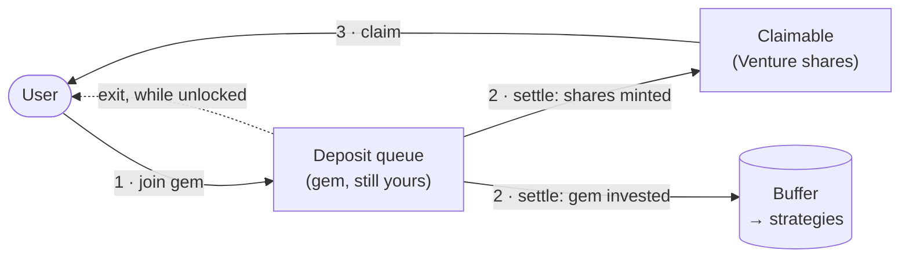
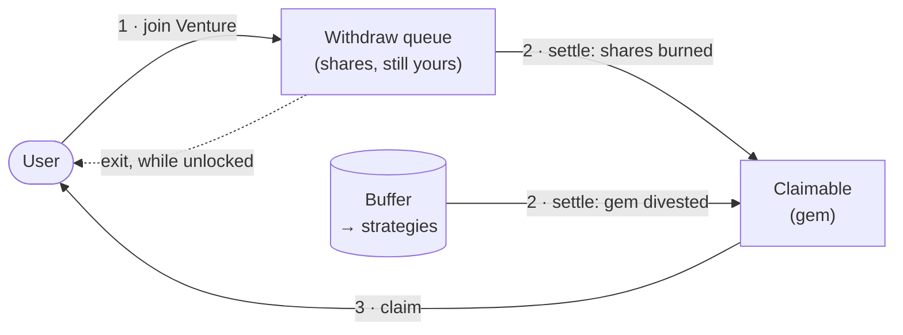

# Venture

Venture is a settlement-cycle module for the Sky stars. It collects a stable asset — the `gem` — from
users, deploys it into higher-risk strategies, and issues `Venture` in return: a claim token whose worth is
tracked by `chi`, the rate accumulator. Gains and losses on the deployed assets move `chi`, so holders take
the risk of the strategies the star runs.

Subscriptions and redemptions are not immediate. Users join a queue and, once per cycle, the planner decides
how much of each queue converts. That conversion is the only thing that turns queued gem into shares, or
shares back into gem.

## Contracts

| | |
|---|---|
| `Venture` | The claim token. An ERC20 with permit, priced by `chi`. Holds no assets itself. |
| `VentureHandler` | Custody, both queues, and the daily lock/plan/settle cycle. |
| `VentureBeam` | The facilitator's entry point, bounding what any plan may contain. |
| `VentureMom` | Emergency authority: halt the beam, zero its limits, zero a pending plan. |

## Settlement cycle

Each cycle runs to a fixed daily schedule. A facilitator calls `lock()` inside the lock window, which closes
both queues; while locked they `plan()` the cycle — how much to revalue `chi` by, and how much capacity each
queue gets. After `settleTime` anyone may call `settle()`, which applies the revaluation, converts both
queues up to their capacity, and reopens them. `VentureBeam` caps how far a single plan may move `chi` and
how much capacity it may hand out.

## Where the gem is, and whose it is

Gem never changes state on its own; it moves only at settlement, and each state is accounted for separately.
When a user joins the deposit queue their gem is transferred to the `VentureHandler` and stays **theirs** —
counted in `deposits().totalUnderlying`, exitable at any time while the queue is unlocked. That changes at
settlement: once the planner allocates capacity to the queue, `settle()` mints `Venture` shares against the
gem it converts and pushes that gem out to the `buffer`. The depositor's claim has changed form rather than
moved — they now hold shares instead of gem, credited to their queue position until claimed. Redemption runs
the same path backwards: queued shares stay the redeemer's until conversion, which pulls the exact gem owed
back from the buffer and burns the shares, leaving that gem in the handler as an unclaimed reward.

The invariant this produces is the point of the split: **the gem sitting in the handler is only ever queued
deposits plus unclaimed withdraw rewards, every unit of it owed to a specific user**, while everything
backing outstanding shares lives at the buffer or is deployed to external strategies.

### Subscribing — gem becomes shares

### Redeeming — shares become gem

Everything in the two queues and both *Claimable* boxes sits in the `VentureHandler` and is owed to a user.
Only the buffer holds protocol funds.

Because conversion is rationed by the per-cycle capacity, a position can be partly converted:
`depositBalance` / `withdrawBalance` report what is still queued and `pendingDepositRewards` /
`pendingWithdrawRewards` what has already converted and is waiting to be claimed. A withdraw conversion is
additionally capped by what the buffer holds and has approved to the handler, so a shortfall converts less
rather than reverting — the generation stays open and the remainder rolls into the next cycle.
